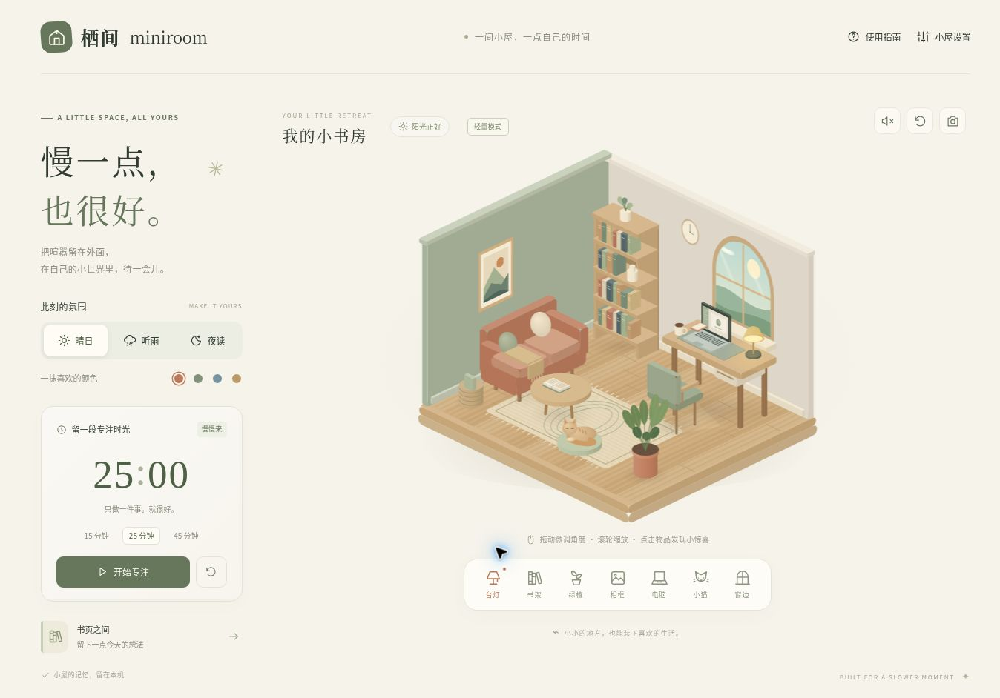
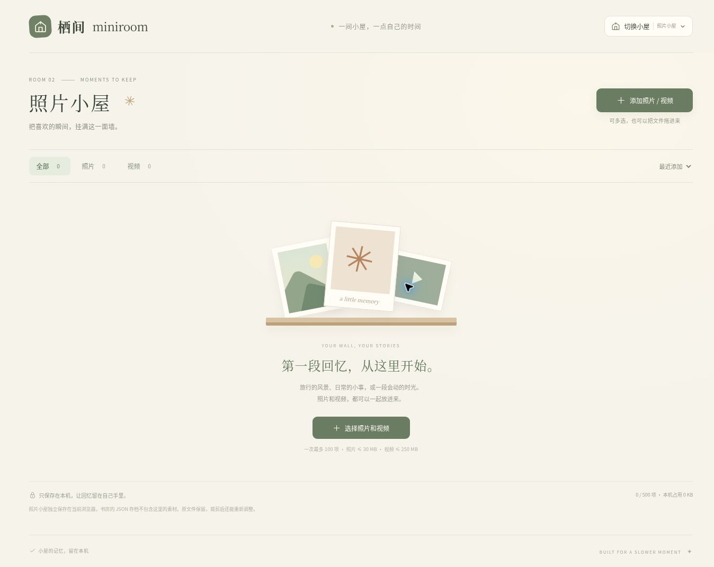

# 栖间 · Miniroom

给生活留一间小屋。一个原创的三维互动书房，使用原生 JavaScript 和 Three.js，在浏览器里运行。



*上图为 WebGL 不可用时的轻量模式实测画面；支持 WebGL 的环境自动使用完整 3D。*

## 1. 打开小屋

### Windows：双击启动

1. 下载本仓库 ZIP 并**完整解压**，或 `git clone https://github.com/TaoPanfeng/miniroom.git`。
2. 双击根目录 **`start.bat`**。
3. 浏览器自动打开 `http://127.0.0.1:8080/`。保持启动窗口打开，关闭窗口即可停止。

Windows 版本使用系统自带的 PowerShell，**不需要 Node.js、Python、npm install 或管理员权限**。如果 8080 端口已被占用，会选择后续空闲端口，以启动窗口显示的地址为准。

### macOS / Linux

安装过 Node.js 18+ 或 Python 3 的电脑，在项目目录执行：

```sh
sh start.sh
```

也可以使用 Node.js 单独启动：

```sh
node scripts/serve.mjs --open
```

需要固定端口时：

```sh
node scripts/serve.mjs --port 8080
```

**请通过启动脚本打开，不要直接双击 `index.html`。** 浏览器对 `file://` 下 JavaScript 模块和资源加载有限制。

## 2. 在小屋里做什么

- 拖动旋转、滚轮缩放，随时恢复默认视角。
- 点击房间里的物品，或使用界面上的物品入口。
- 切换昼夜、台灯和雨天氛围。
- 使用专注计时器，为自己留一段安静时间。
- 查看书架、记下想法，设置自己的相框照片。
- 导出、导入本地设置，方便备份与迁移。

声音需要在点击相关按钮后才会播放；这是浏览器的正常限制。首次打开保持静音。

### 切换小屋与照片墙

顶部点击 **「切换小屋」**，可以在原来的书房与新增的 **「照片小屋」** 之间切换。书房的布局、物品、单张相框、笔记与设置保持独立；切换时会保留原来的视角，返回时恢复环境音设置。照片小屋里的视频在离开或关闭查看窗口时停止播放。



- **多选添加**：一次选择或拖入多张照片、多段视频，也可以混合添加；显示处理进度与未成功文件的原因。
- **照片墙**：缩略图陈列，点击查看大图或播放视频，支持按照片／视频筛选。
- **多选整理**：进入多选模式，可以全选、批量移除，或将所选照片依次裁剪。
- **缩放裁剪**：拖动调整位置，用滑块、滚轮或双指缩放；支持原图、方形、横向和纵向比例。裁剪仅改变展示图，原件保留，可以重新构图。
- **视频播放**：使用浏览器原生播放器；能否播放取决于浏览器支持的编码，推荐 H.264 MP4 或 WebM。
- **本地保存**：刷新后保留；每次最多添加 100 个文件，总计最多 500 项。照片单张最大 30 MB，视频单个最大 250 MB，实际可保存数量还取决于当前浏览器的存储空间。

照片小屋素材只保存到当前浏览器，不会上传到 GitHub，也不会自动出现在其他设备上。**书房的 JSON 存档只包含书房数据，不包含照片墙的照片和视频。** 请保留电脑上的原始文件；照片墙查看窗口也提供下载原文件的入口。清理站点数据会清除本机保存的照片墙。

### 两种显示模式

- **完整 3D 模式**：浏览器支持 WebGL 时，使用 Three.js 绘制三维房间，可在设定范围内旋转和缩放视角。
- **Canvas 2D 轻量模式**：WebGL 不可用时自动启用，以等轴测画面显示小屋。物品点击、昼夜和灯光、雨声、专注计时、笔记、照片及存档功能仍然保留，但视角转动范围和立体效果有所限制。

两种模式使用同一份本地存档。轻量模式不需要额外下载；若要使用完整 3D，请在支持 WebGL 的浏览器环境中开启图形加速后重新打开小屋。

## 3. 本地与在线

- **本地运行**：模型由程序生成，Three.js 等运行资源随仓库提供，不依赖在线 CDN。完整下载后，小屋核心功能可以断网使用。
- **在线入口**：GitHub Pages 的目标地址为 [https://taopanfeng.github.io/miniroom/](https://taopanfeng.github.io/miniroom/)。实际发布状态以仓库 Actions 中的部署结果为准。
- **单一分支**：源代码与发布配置统一维护在 `main`，无需额外的 `gh-pages` 分支。

设置、笔记和选择的照片保存在当前浏览器的本地存储中，不会因使用应用自动写入本仓库。不同浏览器、在线站点与本地地址使用各自独立的存档；更换本地端口也会切换存档。浏览器清理站点数据或使用隐私窗口可能使这些数据丢失，请按需导出备份。

本地服务默认只绑定 `127.0.0.1`，供当前电脑访问。`--host` 参数供开发预览使用；日常启动无需设置。

## 4. 项目结构

| 位置 | 用途 |
| --- | --- |
| `index.html`、`styles.css` | 页面与界面样式 |
| `src/` | 原创房间、交互、声音与本地数据逻辑 |
| `vendor/` | 固定版本的 Three.js 及所需附加模块 |
| `assets/` | 本地界面资源 |
| `scripts/serve.ps1` | Windows 无额外依赖的本地服务 |
| `scripts/serve.mjs` | Node.js 本地服务及开发预览 |
| `.github/workflows/` | GitHub Pages 发布配置 |

直接修改源文件并刷新即可开发，无需编译。Three.js 和随附官方模块遵循 MIT 许可证，第三方许可证保留在 `vendor/` 中。房间使用原创程序几何，没有复制参考网站的场景或素材。

## 5. 常见情况

1. **打开后空白**：确认通过 `start.bat` / `start.sh` 打开，且完整解压了 `vendor` 和 `src`；使用新版 Chrome、Edge、Firefox 或 Safari。WebGL 不可用时应自动切换为轻量模式；若希望显示完整 3D，再检查浏览器的图形加速设置。
2. **命令行窗口关闭后无法刷新**：重新运行启动脚本。本地页面需要这个静态文件服务保持运行。
3. **网页和本地看不到同一份笔记**：这是两个独立地址的本地存档，使用导出和导入功能迁移。
4. **端口被占用后旧设置消失**：查看地址栏端口；关闭旧服务后重新用原端口启动，或导入已保存的备份。
5. **Windows 阻止启动脚本**：先确认下载来源是本仓库并已完整解压。受公司设备策略管理的电脑可按允许的方式使用 Node.js 本地服务，不需要修改系统安全策略。

## 6. GitHub Pages 自动发布

仓库包含 `.github/workflows/pages.yml`。每次更新 `main`，工作流会检查 JavaScript 与本地资源、打包静态文件，再发布 GitHub Pages。

新仓库首次发布需在 **Settings → Pages → Build and deployment → Source** 选择 **GitHub Actions**。启用后，在 **Actions → Publish Miniroom** 运行工作流，或重新运行此前因 Pages 未启用而失败的任务。后续提交自动更新页面，整个过程只使用 `main` 一个分支。
